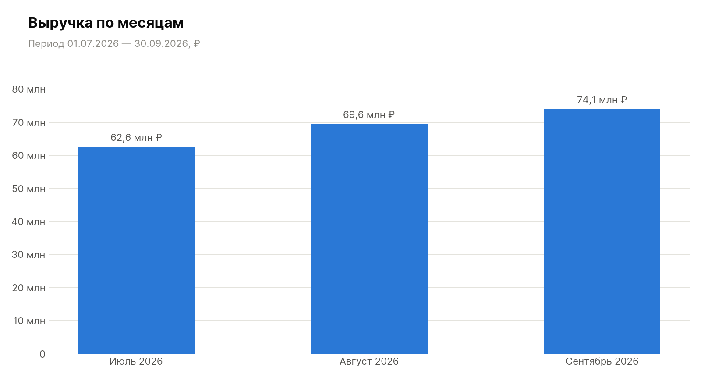
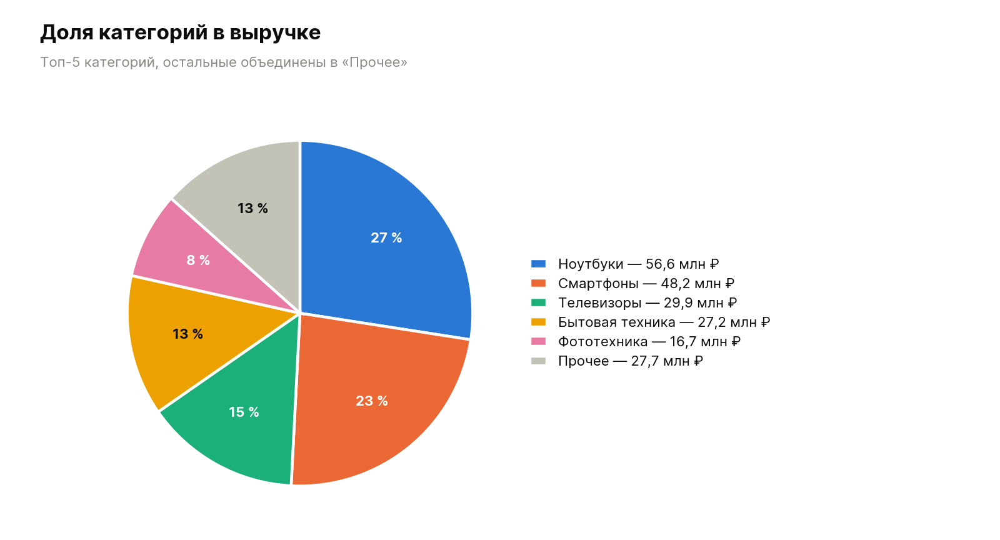
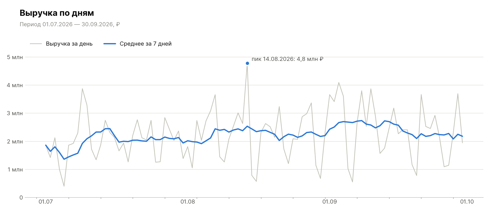
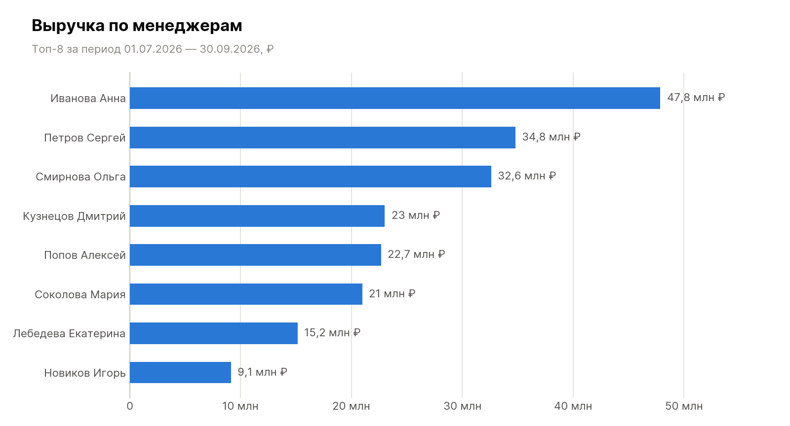
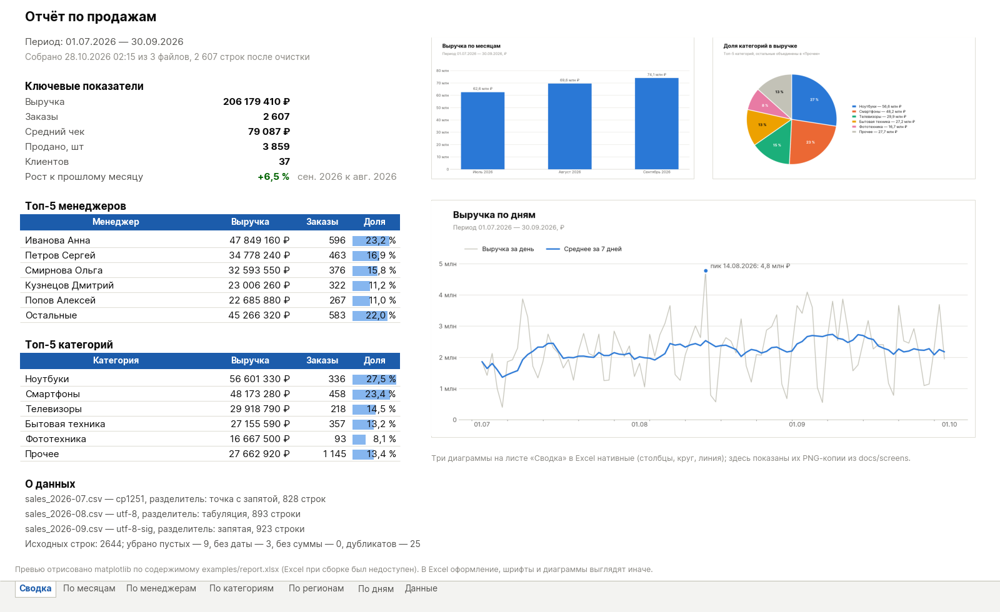
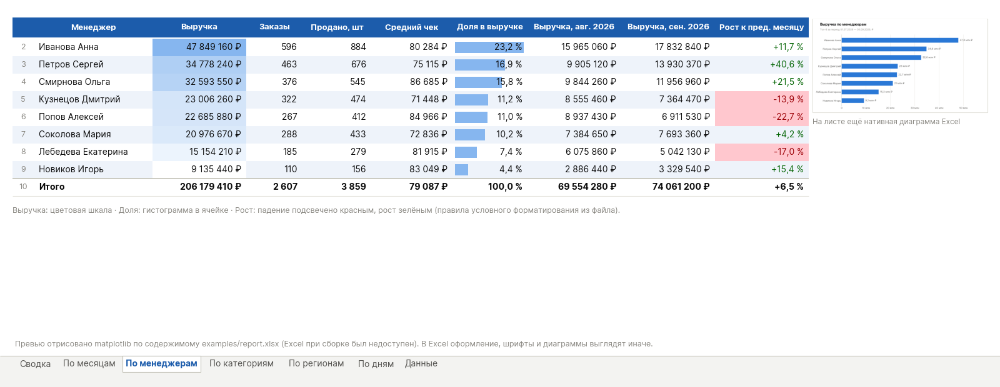

# Сборщик отчётов Excel

Скрипт на Python, который из выгрузок продаж (CSV и XLSX из 1С, CRM, интернет-магазина) собирает готовый отчёт `report.xlsx`: сводка с ключевыми показателями, разбивки по месяцам, менеджерам, категориям и регионам, нативные диаграммы Excel и очищенная таблица с фильтрами. Одна команда вместо часа ручной работы в Excel.

Пример результата: [examples/report.xlsx](examples/report.xlsx) — собран из демо-выгрузок в [data/](data/). PNG-графики и превью листов — в [docs/screens](docs/screens).

Демо для портфолио: компания вымышленная, цены и имена — примеры.

## Что умеет

- Берёт сразу несколько файлов: `--input "data/*.csv" exports/ прочее.xlsx` — маски, папки и отдельные файлы.
- CSV читает без настройки: сам определяет кодировку (utf-8, utf-8 с BOM, cp1251) и разделитель (`;`, `,`, табуляция). XLSX читает через openpyxl.
- Колонки в разных выгрузках могут называться по-разному («Дата», «Дата заказа», `order_date`) — соответствия задаются в `config.yml`, для каждого файла подбираются автоматически.
- Чистит данные: убирает пустые строки и дубликаты, разбирает даты в разных форматах (`01.07.2026`, `2026-07-01`, `03.07.2026 14:20`, числа Excel), суммы с пробелами, запятой и валютой (`12 500,00 руб.`, `1,234.50`, `12 500 ₽`), лишние пробелы в названиях.
- Считает: выручку, число заказов, средний чек, количество, число клиентов, рост к прошлому месяцу, доли и топ-N.
- Собирает `xlsx` с листами:
  - «Сводка» — заголовок с периодом и датой сборки, ключевые показатели, топ-5 менеджеров и категорий, три диаграммы, справка об исходных файлах и очистке;
  - «По месяцам», «По менеджерам», «По категориям», «По регионам», «По дням» — таблицы с итогами, автофильтром и закреплённой шапкой;
  - «Данные» — очищенная таблица как «умная» таблица Excel с фильтрами.
- Нативные диаграммы Excel (их можно править в самом Excel): столбцы выручки по месяцам, круг по категориям, линия по дням, горизонтальные столбцы по менеджерам и регионам.
- Условное форматирование: цветовые шкалы по выручке, гистограммы долей в ячейках, падение к прошлому месяцу подсвечено красным, рост — зелёным.
- Числовые форматы (рубли, проценты, даты), подобранные ширины колонок, заголовки, итоги.
- `--png папка` дополнительно сохраняет те же графики картинками (matplotlib) для презентации или письма.
- `sample` генерирует демо-выгрузки: три месяца, около 2 600 строк, разные разделители, кодировки и названия колонок, плюс «грязь» — дубликаты, пустые строки, суммы с «руб.», даты с временем.
- В консоли показывает, что сделал: кодировку и разделитель каждого файла, какие колонки куда сопоставил, сколько строк убрал и почему.

## Стек

Python 3.9+, pandas, openpyxl, PyYAML, matplotlib. Тесты — pytest. Внешних сервисов и API нет, всё работает локально.

## Скриншоты

Графики, которые сохраняет `--png` (те же, что строятся диаграммами в Excel):









Превью листов «Сводка» и «По менеджерам». Это не снимки Excel: при сборке Excel был недоступен, поэтому содержимое `examples/report.xlsx` отрисовано скриптом `scripts/render_preview.py` по тем же данным и правилам форматирования. Точный вид в Excel — откройте файл из `examples/`.





## Запуск

```bash
pip install -r requirements.txt
python -m report_builder sample --out data
python -m report_builder build --input "data/*.csv" --config config.yml --out report.xlsx --png charts
```

Маску `data/*.csv` берите в кавычки, чтобы её раскрывал скрипт, а не оболочка. Без `--config` используются названия колонок по умолчанию (те же, что в `config.yml`). Все параметры: `python -m report_builder build --help`.

Вывод команды на демо-данных:

```
Файлы:
  sales_2026-07.csv — cp1251, разделитель: точка с запятой, 828 строк
  sales_2026-08.csv — utf-8, разделитель: табуляция, 893 строки
  sales_2026-09.csv — utf-8-sig, разделитель: запятая, 923 строки
Колонки:
  sales_2026-07.csv: Дата ← Дата, Сумма ← Сумма, Количество ← Количество, ...
  sales_2026-08.csv: Дата ← Дата заказа, Сумма ← Сумма, руб, Количество ← Кол-во, ...
  sales_2026-09.csv: Дата ← date, Сумма ← amount, Количество ← qty, ...
Очистка: 2 644 → 2 607 строк (пустых 9, без даты 3, без суммы 0, дубликатов 25)
Период: 01.07.2026 — 30.09.2026
Выручка 206 179 410 ₽ · заказов 2 607 · средний чек 79 087 ₽ · рост к прошлому месяцу +6,5 % (сен. 2026 к авг. 2026)
Готово: report.xlsx — 7 листов, 8 диаграмм
PNG: charts — 4 файла
```

Тесты: `pip install -r requirements-dev.txt && pytest` (43 теста: чтение CSV с разными разделителями и кодировками, XLSX, сопоставление колонок, разбор сумм и дат, расчёт показателей, состав листов и диаграмм в готовом файле, запуск через командную строку).

## Как адаптировать под свою выгрузку

Все настройки — в `config.yml`, код менять не нужно.

```yaml
columns:
  date: ["Дата", "Дата заказа", "date"]
  amount: ["Сумма", "Сумма, руб", "amount"]
  quantity: ["Количество", "Кол-во", "qty"]
  manager: ["Менеджер", "Продавец"]
  category: ["Категория", "Группа товаров"]
  region: ["Регион", "Город"]
  client: ["Клиент", "Контрагент"]

report:
  title: "Отчёт по продажам"
  currency: "₽"
  top_n: 5

cleaning:
  drop_duplicates: true
  drop_negative: false
  date_formats: ["%d.%m.%Y", "%Y-%m-%d"]

input:
  sheet: 0
```

| Раздел | Что настраивает |
|---|---|
| `columns` | Для каждого поля — список названий колонок, под которыми оно может встречаться в выгрузках (регистр и лишние пробелы не важны). Обязательны только `date` и `amount`; если нет менеджеров, категорий или регионов — соответствующие листы и диаграммы просто не строятся. |
| `report.title` | Заголовок на листе «Сводка» и название файла в свойствах. |
| `report.currency` | Знак валюты в числовых форматах и подписях (`₽`, `руб.`, `$`). |
| `report.top_n` | Сколько строк в топах на «Сводке» и секторов на круговой диаграмме; остальное объединяется в «Прочее». |
| `cleaning.drop_duplicates` | Убирать ли полностью одинаковые строки. |
| `cleaning.drop_negative` | Убирать ли строки с отрицательной суммой (возвраты). |
| `cleaning.date_formats` | Форматы дат в порядке проверки; всё, что не подошло, скрипт пытается разобрать автоматически. |
| `input.sheet` | Какой лист брать из XLSX: номер с нуля или название. |

Если нужна ещё одна разбивка (например, по каналам продаж), в `report_builder/config.py` добавьте поле в `FIELDS` и `LABELS`, в `report_builder/metrics.py` — в `DIMENSIONS`, в `report_builder/excel.py` — название листа в `SHEET_NAMES`. Остальное (сводка, таблица, диаграмма, форматирование) соберётся по общему шаблону.

Если выгрузка в XLSX с несколькими листами или с шапкой не в первой строке, проще всего сохранить нужный диапазон отдельным файлом, либо указать лист в `input.sheet`.

## Структура проекта

```
report_builder/
  cli.py          команды build и sample (argparse)
  config.py       чтение config.yml и значения по умолчанию
  readers.py      поиск файлов, автоопределение кодировки и разделителя, чтение CSV и XLSX
  cleaning.py     сопоставление колонок, разбор дат и сумм, удаление пустых строк и дубликатов
  metrics.py      сводки pandas: KPI, по месяцам, по дням, по измерениям, топ-N
  excel.py        сборка xlsx: листы, диаграммы, условное форматирование, числовые форматы
  charts_png.py   те же графики в PNG (matplotlib)
  sample.py       генератор демо-выгрузок
tests/            pytest
data/             демо-выгрузки (сгенерированы командой sample)
examples/         пример готового отчёта
docs/screens/     графики и превью листов
scripts/          render_preview.py — превью листов для README
```

## Картинки

Все изображения в репозитории построены кодом (matplotlib) по демо-данным, сторонних картинок нет. Имена менеджеров, клиентов, категории и суммы — примерные данные для демонстрации.
